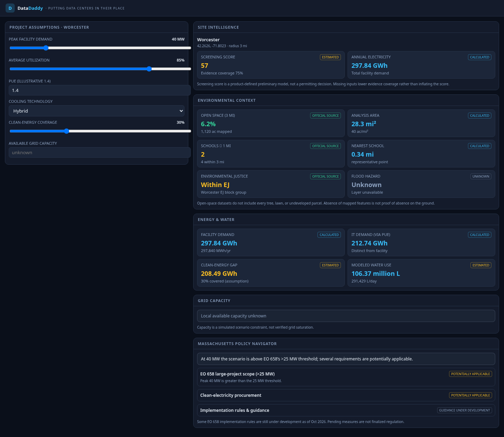

# DataDaddy

**Putting data centers in their place.** · *Intelligence for where AI infrastructure belongs.*

DataDaddy is an AI-powered geospatial intelligence platform that evaluates where data
centers could be developed across Massachusetts and models how their construction and
operation might affect electrical infrastructure, environmental sustainability, green
space, nearby communities, and local economic conditions.

> Built for **Hackachusetts 2026** · Climate Tech track · developed with **Kiro** using a
> spec-driven workflow (see [`KIRO_USAGE.md`](./KIRO_USAGE.md) and [`.kiro/`](./.kiro)).



*Live site-intelligence dashboard: a 40 MW data center at Worcester resolves to 297.84 GWh/yr
facility demand, a modeled water estimate, mapped open-space / school / EJ context, and EO 658
regulatory findings — every value labeled by provenance. Open the [public demo](https://mnsalschool7-u.github.io/DataDaddy/). The legacy standalone HTML uses representative data; the Next.js app queries official services.*

---

## 1. What DataDaddy does
An interactive spatial decision-support terminal. Click any location in Massachusetts,
simulate a hypothetical data center, and immediately see modeled consequences for energy,
water, green space, schools, environmental justice, grid capacity, community cost, and
Massachusetts regulatory applicability — with every value labeled by provenance.

## 2. The problem it solves
AI infrastructure demand is growing faster than the public understanding of where it can
responsibly go. Developers, municipalities, and residents lack a transparent tool to
explore the *tradeoffs* of siting a facility. DataDaddy models those tradeoffs openly
instead of asserting unverifiable conclusions.

## 3. Why Massachusetts
Massachusetts has rich open MassGIS datasets and has just issued **Executive Order 658
(Sept 8, 2026)** establishing requirements for responsible data center development —
making it an ideal place to connect geospatial analysis to live regulatory intelligence.

## 4. Technical architecture
- **Next.js (App Router) + React + TypeScript + Tailwind** UI.
- **MapLibre GL JS** interactive map, **Turf.js** spatial analysis, **GeoJSON** layers,
  OpenStreetMap tiles (attributed, no API key).
- **Recharts** for charts; **Lucide** icons.
- **Pure, deterministic model layer** in `src/lib/model` (energy, water, clean energy,
  grid, cost, scoring) with **Zod**-validated inputs (`src/lib/schemas.ts`).
- **Policy engine** in `src/lib/policy` (EO 658 threshold logic + tax exemption).
- **Next.js API route** `/api/analyst` — deterministic grounded analyst, optional LLM.
- **Vitest + fast-check** tests colocated with the model/geo modules.

```
src/
  app/            routes: / (map+sim), /scenario-lab, /compare, /policy, /methodology, /report, /api/analyst
  components/     map, panels, charts, ui primitives, SimulationProvider (global state)
  lib/
    model/        pure simulation + scoring (+ *.test.ts)
    geo/          Turf spatial analysis (+ *.test.ts)
    policy/       MA regulatory rule engine (+ *.test.ts)
    data/         provenance types, source registry, loaders, municipalities
    analyst/      analyst context + deterministic generator
    schemas.ts    Zod schemas / defaults
public/data/      legacy representative fixtures (not used by live dashboard)
scripts/          fetch-data.ts (real-feed integration check) + legacy demo generator
.kiro/            specs, steering, hooks (Kiro development artifacts)
```

## 5. Datasets used
Official MassGIS layers (municipalities, protected & recreational open space, schools, 2020
environmental justice populations), ISO New England RSP for regional context, and the MA
policy sources. See the **Data & Methodology** page and `src/lib/data/sources.ts` for full
attribution and limitations. The browser queries official MassGIS/EEA ArcGIS services directly:
- Statewide municipality boundaries (351 towns) and the published 2020 Census population.
- Statewide school roster, paginated completely for distance and proximity calculations.
- Protected/recreational open-space polygons intersecting the selected radius.
- Designated EJ2020 block groups around the site (only `EJ = Yes`).

Each location/radius change cancels obsolete requests, clears previous geographic results,
and recalculates the screening assessment after fresh data arrives. Successful responses
are cached in memory for ten minutes. Source links and retrieval times appear in the sidebar.
A failed source remains unknown; there is no representative-data fallback. This also works
on static GitHub Pages hosting because the official services allow browser CORS requests.
`npm run fetch-data` checks the real services at Worcester and Lowell and verifies that their
geographic metrics differ. The legacy GeoJSON generator is not used by the dashboard.

Facility electricity/water demand remains a scenario calculation, not measured local usage.
Flood hazard and verified local utility capacity remain unavailable. The Community page's
housing context is explicitly labeled as curated approximations, not official live observations.

## 6. How the simulator works
Energy: `annualFacilityMWh = peakMW × 8760 × utilization` (40 MW @ 85% → **297.84 GWh/yr**);
IT demand = facility / PUE. Water: `IT kWh × WUE`. Grid: `remaining = available − cumulative`
(unknown capacity stays **unknown**). Cost: household exposure sensitivity. Scoring: a
transparent 0–100 weighted screen where unknown components lower *evidence coverage* rather
than inventing favorable values. Full formulas live on the **Data & Methodology** page.

## 7. Run the project
```bash
npm install
npm run dev                               # http://localhost:3000
```
Use Node 20 or 22. Official map data requires internet access but **no API keys**. Optional LLM analyst: copy `.env.example` to
`.env.local` and set `OPENAI_API_KEY` (degrades gracefully to the deterministic analyst).

## 8. Run tests & checks
```bash
npm run typecheck   # tsc --noEmit
npm run lint        # eslint
npm test            # vitest (unit + fast-check property tests)
npm run build       # next production build
```

## 9. How Kiro was used
Spec-driven development (`.kiro/specs/datadaddy/`), five steering documents
(`.kiro/steering/`), agent hooks (`.kiro/hooks/`), MCP-style research of official sources,
and property-based testing. Full detail in [`KIRO_USAGE.md`](./KIRO_USAGE.md).

## 10. Limitations & future development
- Live geographic results depend on the official services and their publication schedules.
  Empty successful queries and failed requests are represented separately.
- Flood hazard and documented-data-center layers are shown as *unavailable* in this build.
- Grid capacity is **scenario-based**, never asserted as verified distribution headroom.
- Future: utility-territory capacity data, verified housing feeds, richer grid-stress viz,
  and persisted multi-project cumulative pressure maps.

> **Integrity note:** DataDaddy presents a *preliminary screening model*. It is not a
> permitting decision, legal approval, or regulatory certification, and it does not predict
> actual utility rates, rents, or health outcomes.
